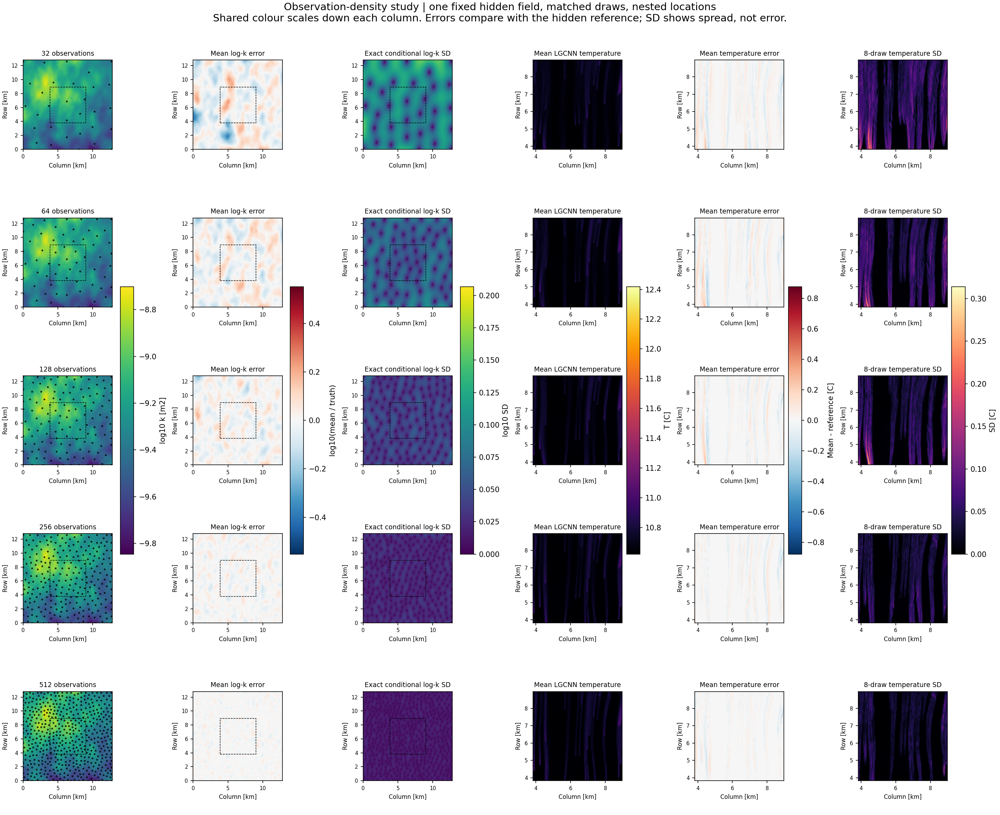
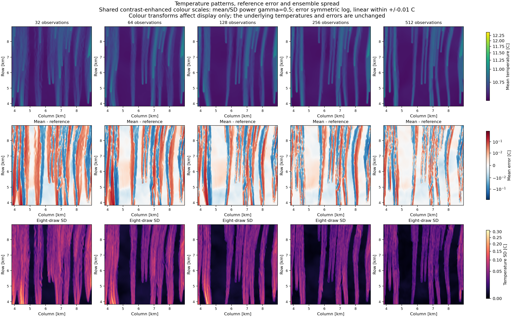

# Completed spatial density study: all inputs, outputs and deviations

Study `density-visual-856442423a833308c75a`. RUN 2 structural prior; one fixed synthetic hidden truth; eight matched draws per count.

**All five counts, including 512 observations, completed successfully:** 40 actual conditional LGCNN queries and one hidden-reference query. Every native input/output array is retained.

[Open the complete local gallery](../run_output/conditional_density_visual_20261026/report.html) in a normal browser, or [use the complete static report](../run_output/conditional_density_visual_20261026/report.md). The gallery shows all eight samples at each count, individual signed reference errors, deviations from the empirical ensemble mean, observation overlays and native-array links.

## All eight fields at each observation count

Each atlas contains every sample and its signed deviation against the same hidden reference. Shared error scales support comparisons across counts; detail scales make small high-density deviations visible and are labelled as local.

| Observations | Eight permeability inputs + errors | Eight temperature outputs + errors | High-density detail views |
|---:|---|---|---|
| 32 | [Input maps](../run_output/conditional_density_visual_20261026/figures/n-0032-inputs-shared.png) | [Output maps](../run_output/conditional_density_visual_20261026/figures/n-0032-outputs-shared.png) | [Inputs](../run_output/conditional_density_visual_20261026/figures/n-0032-inputs-detail.png) · [Outputs](../run_output/conditional_density_visual_20261026/figures/n-0032-outputs-detail.png) |
| 64 | [Input maps](../run_output/conditional_density_visual_20261026/figures/n-0064-inputs-shared.png) | [Output maps](../run_output/conditional_density_visual_20261026/figures/n-0064-outputs-shared.png) | [Inputs](../run_output/conditional_density_visual_20261026/figures/n-0064-inputs-detail.png) · [Outputs](../run_output/conditional_density_visual_20261026/figures/n-0064-outputs-detail.png) |
| 128 | [Input maps](../run_output/conditional_density_visual_20261026/figures/n-0128-inputs-shared.png) | [Output maps](../run_output/conditional_density_visual_20261026/figures/n-0128-outputs-shared.png) | [Inputs](../run_output/conditional_density_visual_20261026/figures/n-0128-inputs-detail.png) · [Outputs](../run_output/conditional_density_visual_20261026/figures/n-0128-outputs-detail.png) |
| 256 | [Input maps](../run_output/conditional_density_visual_20261026/figures/n-0256-inputs-shared.png) | [Output maps](../run_output/conditional_density_visual_20261026/figures/n-0256-outputs-shared.png) | [Inputs](../run_output/conditional_density_visual_20261026/figures/n-0256-inputs-detail.png) · [Outputs](../run_output/conditional_density_visual_20261026/figures/n-0256-outputs-detail.png) |
| 512 | [Input maps](../run_output/conditional_density_visual_20261026/figures/n-0512-inputs-shared.png) | [Output maps](../run_output/conditional_density_visual_20261026/figures/n-0512-outputs-shared.png) | [Inputs](../run_output/conditional_density_visual_20261026/figures/n-0512-inputs-detail.png) · [Outputs](../run_output/conditional_density_visual_20261026/figures/n-0512-outputs-detail.png) |

## Spatial overview

Columns show observation coverage, mean log-permeability error, analytical input SD, mean temperature, temperature reference error and empirical temperature SD. The dashed square marks the temperature output crop within the full permeability input.

## Temperature patterns with enhanced display contrast

These are the same frozen temperatures and errors. Shared nonlinear colour scales make faint plumes and small signed errors visible: power normalization gamma=0.5 for mean/SD and a symmetric-log error scale, linear within +/-0.01 C. The full sample atlases use their original shared linear scales.

## Numerical findings

| Observations | Exact input SD RMS [log10] | Mean input error RMS [log10] | Temperature SD RMS [C] | Mean temperature error RMS [C] |
|---:|---:|---:|---:|---:|
| 32 | 0.09466 | 0.08324 | 0.05438 | 0.05008 |
| 64 | 0.06157 | 0.06051 | 0.04568 | 0.05213 |
| 128 | 0.03793 | 0.04397 | 0.04015 | 0.04482 |
| 256 | 0.02261 | 0.02481 | 0.02956 | 0.03543 |
| 512 | 0.01341 | 0.01413 | 0.02443 | 0.03009 |

From 32 to 512 observations, analytical input SD RMS falls by 85.8%, temperature SD RMS by 55.1%, and ensemble-mean temperature RMSE by 39.9%. Temperature mean error increases slightly at 64 observations before declining at higher counts. These outcomes are retained. Error is measured against the fixed hidden reference; SD measures spread across eight possible fields. Their equality is neither assumed nor established by this one-truth study.

## Verification and interpretation

The full suite passed 654 tests. The independent native audit passed 159 source/model hash checks and 508 artifact checks, verified every input/output query pair, and independently evaluated conditioning at 192 additional grid cells for each count. Maximum independent Matheron discrepancy is 2.57e-08 log10 and maximum exact-reading conversion error is 2.56e-08 log10. Float32 temperature-summary rounding is recorded explicitly in the audit. All synced project sources remain unchanged.

An offline JavaScript execution check exercised count/sample/contrast/view controls and verified 320 image/array links. The in-app browser blocks local-file URLs, so browser rendering was not automated. The PNG atlases were visually inspected; the HTML gallery can be opened locally.

One synthetic truth, one geometry-only broad layout and eight draws per count illustrate this declared input model. They do not establish geological accuracy, coverage calibration, tail convergence or an optimal real-world sampling density. The hidden temperature is an LGCNN prediction; model-versus-simulator discrepancy is outside this study.

[Protocol, model assumptions and reproduction](conditional_density_visual.md) · [Portable numerical results](conditional_density_visual_summary.json)
