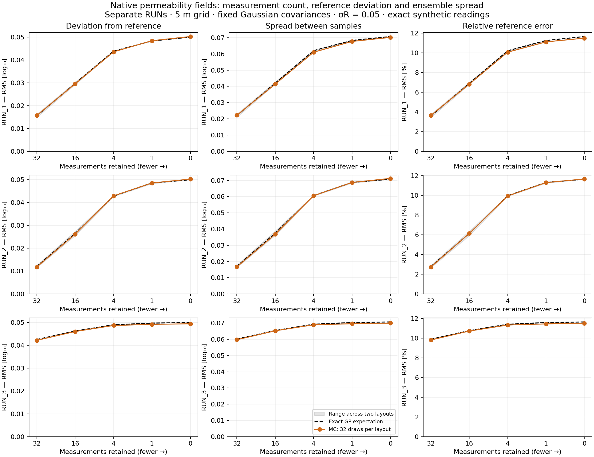

# Native permeability deviation study (2026-10-24)

Executed computational commit `76581609c8933fcb8156bac9b8b7ac27f5d41c92` on `feat/reference-field-uq`.
Three separate original 2560 × 2560 references, 5 m native cells; no grid coarsening.
Gaussian 40–2560 m texture-fit lengths and `sigma_R=0.05` are unchanged assumptions.
Reference-median centering, exact synthetic readings and variance-guided placement
with 500 m minimum spacing are kept fixed. No trained temperature model is queried.

## Configuration and outputs

- Nested counts **0, 1, 4, 16, 32**; two independent layouts per RUN; **32 draws per setting**.
- **30 settings / 960 conditional fields**, using 192 cached independent FFT priors with paired seeds across counts.
- All 496 unordered sample pairs per setting are summarized; they are dependent comparisons.
- 60 full native permeability arrays retained by fixed indices (draws A and B), plus their log-difference maps.
- Native analytic/empirical SD maps, mean log-bias, per-sample metrics and pair-distance matrices.
- Per RUN: `*.fields.png`, `*.deviations.png` and `*.curves.png`. Shared scales allow comparisons as counts decrease.

See the [workflow, equations and Git Bash command](conditioning_deviation.md) and
[executed configuration](../configs/conditioning_deviation.native.yaml). Large outputs stay local in
`run_output/conditioning_deviation_native_20261024`.

## Quantitative comparison

The shaded range spans the two exact layout-specific expectations; it is not a confidence interval.

Distances below are RMS over the full native grid and separately conditioned designs.
Exact columns are square roots of expected squared distances under the declared GP;
MC columns use 32 draws. They are not averages of individual field RMSEs.

| RUN | n | Reference RMS exact / MC [log10] | Between-sample RMS exact / MC [log10] | Relative reference RMS exact [%] |
|---|---:|---:|---:|---:|
| RUN_1 | 0 | 0.05000 / 0.05024 | 0.07071 / 0.07019 | 11.65 |
| RUN_1 | 1 | 0.04830 / 0.04841 | 0.06831 / 0.06769 | 11.25 |
| RUN_1 | 4 | 0.04385 / 0.04353 | 0.06201 / 0.06106 | 10.20 |
| RUN_1 | 16 | 0.02972 / 0.02953 | 0.04203 / 0.04140 | 6.89 |
| RUN_1 | 32 | 0.01553 / 0.01569 | 0.02197 / 0.02220 | 3.58 |
| RUN_2 | 0 | 0.05000 / 0.05031 | 0.07071 / 0.07122 | 11.65 |
| RUN_2 | 1 | 0.04861 / 0.04860 | 0.06875 / 0.06872 | 11.32 |
| RUN_2 | 4 | 0.04288 / 0.04297 | 0.06064 / 0.06056 | 9.97 |
| RUN_2 | 16 | 0.02652 / 0.02621 | 0.03750 / 0.03682 | 6.14 |
| RUN_2 | 32 | 0.01207 / 0.01181 | 0.01707 / 0.01669 | 2.78 |
| RUN_3 | 0 | 0.05000 / 0.04945 | 0.07071 / 0.06999 | 11.65 |
| RUN_3 | 1 | 0.04974 / 0.04919 | 0.07034 / 0.06962 | 11.58 |
| RUN_3 | 4 | 0.04902 / 0.04870 | 0.06932 / 0.06896 | 11.42 |
| RUN_3 | 16 | 0.04625 / 0.04606 | 0.06541 / 0.06526 | 10.76 |
| RUN_3 | 32 | 0.04254 / 0.04219 | 0.06016 / 0.05974 | 9.89 |

## Interpretation

Fewer retained measurements increase the expected reference deviation and within-setting
spread. With this exact reference-centered law the log-mean stays the reference; the
uncertainty widens rather than an unknown mean being reconstructed. Expected pair RMS
is sqrt(2) times expected reference RMS in the squared-distance convention used here.
Individual coupled draws and finite MC curves need not be monotone. Analytic expectations
are available for these input metrics, so the 8/16/32-draw curves can be judged against
the actual declared-law target rather than treating the largest empirical ensemble as truth.

Two layouts are not a converged expectation over possible site designs. Covariance and
amplitude remain model-form choices; no geological calibration, training-support certificate
or physical pass/fail threshold is inferred. The shorter RUN_3 correlation lengths imply
more local constraints and a different count-versus-uncertainty curve under this assumed law.

## Verification

- Ten new tests compare complete blocked fields/moments/metrics to the existing scalar
  generator for three kernels, exact/noisy readings and the unconditional law. The
  combined focused suite passed 52 tests; the final study tests passed 10 tests.
- Every output/source hash and all retained exact conditioning values were checked.
- Pair-distance matrices were checked against saved draw differences and the identity
  mean(pair RMS²) = 2 × spatial mean(unbiased ensemble variance).
- Analytic uncertainty decreases monotonically as nested measurements are added.
- Zero-measurement retained draws are bitwise equal to the corresponding earlier native pilot draws.
- CI passed on Python 3.11 and 3.12, including the new module and all regression tests:
  [implementation run](https://github.com/TorbenAdelhelm/Masterthesis/actions/runs/40130133530).

Independent audit and numerical table are in the project workspace under
`analysis/conditioning_deviation_20261024/validation.json` and `results.csv`.
