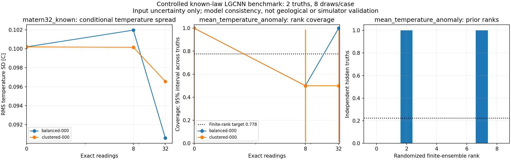
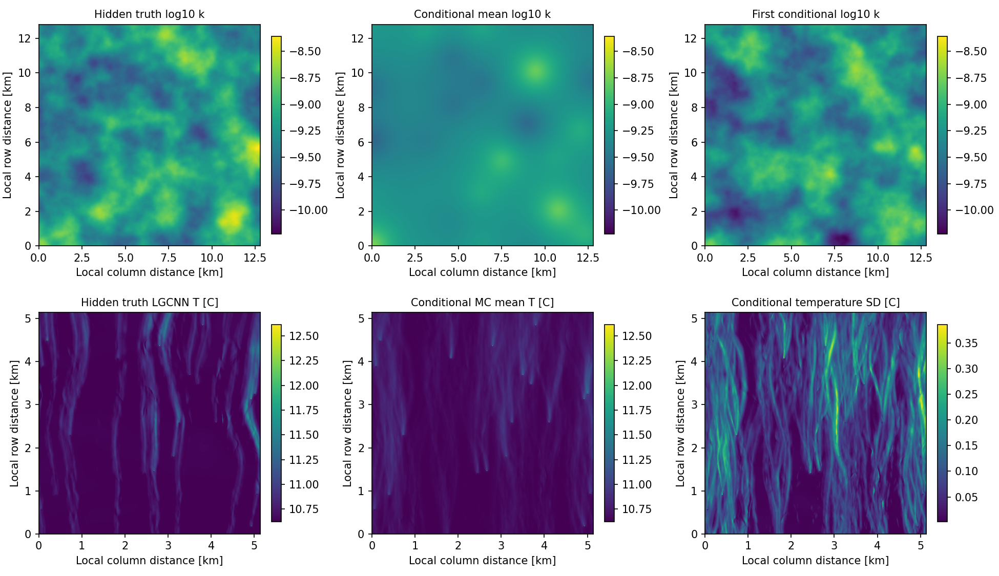

# Controlled conditional-field results: 26 October 2026

**The controlled native pilot completed 82 actual frozen-LGCNN evaluations and
passed an independent output audit.** It demonstrates execution under the
declared law. Two hidden truths and eight posterior draws per case do not
establish temperature calibration, tail convergence or a reliable layout ranking.

The [workflow and probability model](controlled_field_benchmark.md) are now the
main input-UQ experiment. The [RUN reconstruction result](measurement_density_results.md)
remains the separate realism challenge, with its original `validation_failed`
assessment unchanged.

## Completed native pilot

- Study identity: `controlled-4d110227778ffdf9b8e9`.
- One declared known-mean Matern-3/2 log-Gaussian scenario: mean log10(k/m2)=-9.3,
  SD=0.25, isotropic length parameter=1000 m.
- Two independently sampled hidden truths, 8 conditional draws per case,
  exact nested readings at 0/8/32 sites, one broad and one clustered layout.
- 10 uncertainty cases: one shared prior and four conditioned cases per truth.
  80 generated-input evaluations plus 2 hidden-truth evaluations.
- Native input 2560x2560 at 5 m; temperature output 1028x1028. The output offset
  is 766 input cells (3830 m) on each side. Receptors and risk areas use that crop.
- Pressure/material/source inputs and LGCNN checkpoints remain fixed. Truth
  temperatures come from this same LGCNN, rather than from PFLOTRAN.

| Layout | Exact readings | Analytical input RMS SD [log10] | Pilot temperature RMS SD [C] |
|---|---:|---:|---:|
| prior | 0 | 0.2500 | 0.1002 |
| balanced-000 | 8 | 0.2418 | 0.1020 |
| clustered-000 | 8 | 0.2379 | 0.1001 |
| balanced-000 | 32 | 0.2044 | 0.0906 |
| clustered-000 | 32 | 0.2174 | 0.0966 |

Temperature RMS SD is the square root of mean spatial temperature variance
across the two independent trials. These are finite-MC pilot estimates. At 32
readings, both layouts have lower estimated temperature variance than the prior;
the broad layout's estimate at 8 readings increases slightly. All results are
retained. A monotone variance curve for every realized observation set is not
required for a nonlinear response, and this pilot cannot support a layout ranking.

The rank plot uses independent truths, never spatial pixels as iid replications.
With 8 draws, the chosen central rank window has exact model-consistent target
7/9, approximately 77.8%; it is not a 90% interval. The very wide intervals and
sparse histogram make the pilot's statistical limits visible. Additional outputs
include CRPS, receptor/ROI summaries, warming areas, exceedance/severity maps,
empirical temperature quantiles, half-batch checks and nested 4/8 MC checkpoints.

Example: first truth, broad layout, 32 exact readings. The permeability maps use
the full input domain; temperature panels use local coordinates within the valid
output crop. Shared scales compare corresponding fields. The full hidden truth
is used for scoring and display; only its selected readings enter conditioning.

## Independent checks and material limits

The independent audit verified 146 source/model hashes,
258 artifact hashes, all 80 conditional prediction rows,
10 native cases and 80 independently calculated input probe predictions.
It also recomputed temperature moments and CRPS and checked decreasing analytical
input variance under nested observations. Maximum exact-reading discrepancy was
2.32e-08 log10 units after float32 conversion.
The independent Matheron comparison differed by at most
3.57e-08 log10 units.

The final local full suite passes **630 tests**. Two existing constant-field
moment warnings remain in the older geostatistical-target tests. The installed
study command was built and checked. These are local checks; no new remote CI
execution is asserted.

One additional LGCNN regression evaluation in the final code reproduced the
first hidden-truth temperature **bit for bit**, checking that the writable-input
copy leaves the frozen numerical result unchanged. This verification query is
separate from the pilot's 82 experiment evaluations.

No draws were clipped, rejected or replaced. At worst,
0.351% of cells in an evaluated
input/crop exceeded a checkpoint normalization upper bound; none fell below its
lower bound. These fractions are descriptive. Even inputs inside normalization
ranges are not certified to match the training distribution. Input uncertainty,
geological model/parameter uncertainty and LGCNN approximation error remain
distinct; only the first is quantified here.

The pilot's exact executed source was archived and hash-verified before the
final report-axis fix, recovery guard for a changed package installation, and
writable-copy protection for truth inputs. Those final edits do not change the
input law, conditioning or statistics formulas. The frozen run is preserved;
the document figure is regenerated from its unchanged scalar results. See the
portable [results and provenance summary](controlled_field_pilot_summary.json).
Full local products are under `run_output/controlled_field_pilot_native_20261026`;
the executed source snapshot and audit are under
`../analysis/controlled_benchmark_20261026`.

## Larger experiment: prepared and checked, propagation pending

`configs/controlled_field.main.yaml` specifies 64 independent truths, 64 draws
per case, counts 0/8/32/128, and the same two separate coverage scenarios. It
requires **28,736 LGCNN evaluations**. Its current
status is `dense_validated`: planning and independent dense marginal
validation are complete; no main-matrix native inputs or model predictions have
been generated.

Dense validation uses 512 independent joint-Gaussian trials at native observation
and withheld-probe coordinates. Across 128 fixed probe/layout/count rows,
analytical 90% coverage ranges from
87.5% to
93.8%. The maximum disagreement with
independent conditional-Gaussian equations is
1.78e-15. Rows are correlated and are not pooled
into an iid coverage test. These results validate implementation consistency
under the assumed law; they do not validate geological realism.

The pilot median model evaluation took 8.53 s on this machine.
Multiplying by the main budget gives roughly 68 hours for model evaluations
alone; FFT generation, conditioning, I/O and postprocessing add time. This is a
planning extrapolation, not a measured main runtime. The main outputs need about
200 GB of disk space. Inspect MC checkpoints and representative model behavior
before treating the specified budget as sufficient for the scientific claims.

## Supplied paper

Reiser, Aguilar, Guthke and Buerkner (2025), *Uncertainty Quantification and
Propagation in Surrogate-based Bayesian Inference*, arXiv:2312.05153v3, informs
the separation of uncertainty sources and the repeated-truth calibration design
(Table 1, Section 2.3 and Algorithm 1). Its inverse-inference and surrogate-training
uncertainty algorithms are not implemented by this frozen forward benchmark.
The [method note](controlled_field_benchmark.md#how-the-supplied-guthke-paper-informs-this-design)
explains the distinction.
