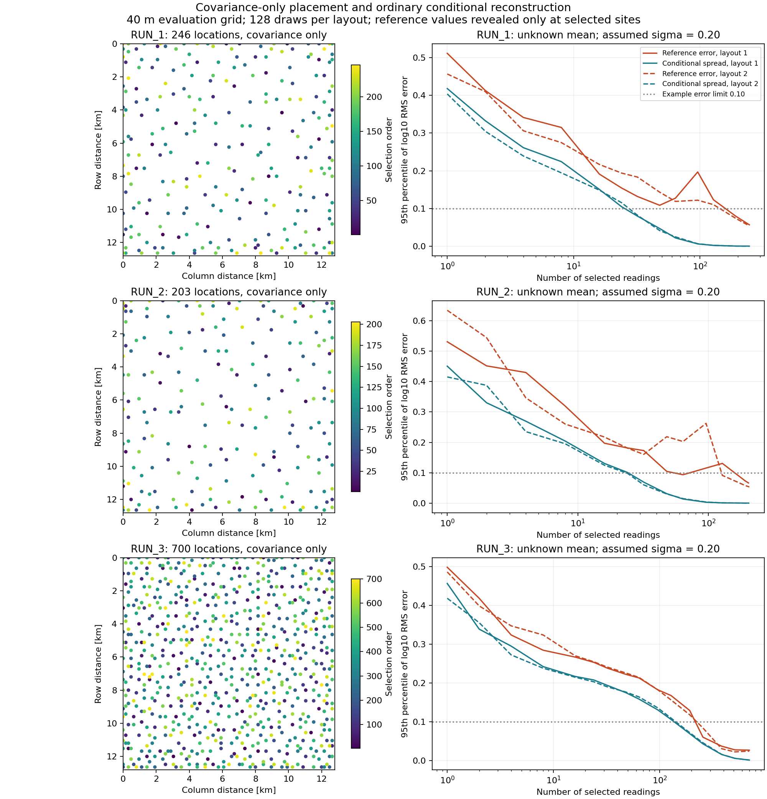
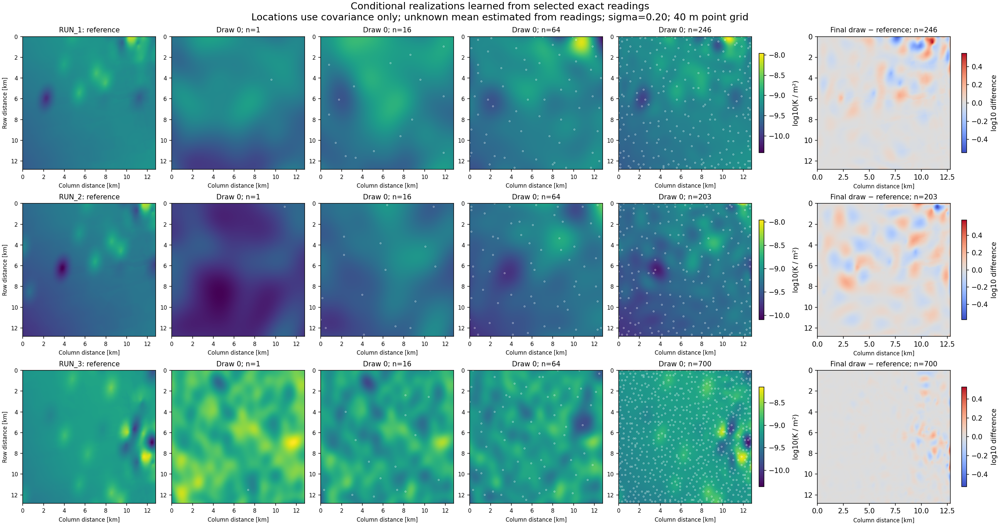

# Covariance-only reconstruction study — 2026-10-25

The [workflow](covariance_reconstruction.md) and
[executed configuration](../configs/covariance_reconstruction.study.yaml) select
locations using covariance and geometry only. The full reference mean and
unobserved reference values do not enter placement or conditioning. Ordinary
kriging estimates an unknown constant mean from the revealed readings and
retains the uncertainty of this estimate. Readings have zero measurement error.

## Executed experiment

- Three separate RUN references, existing Gaussian texture-fit correlation lengths.
- Two seeded, covariance-only location sequences per RUN; nested counts through
  700 where numerically feasible. First location uniform, subsequent probabilities
  proportional to ordinary-kriging variance.
- 128 Gaussian draws per fixed layout/count; total log-field SD assumptions
  0.10, 0.20 and 0.30. These are model-form sensitivities, not calibrated amplitudes.
- 84 fixed-layout/count ensembles, evaluated at three amplitudes: 252 result cases.
  Shared prior draws pair counts, amplitudes and layouts within a RUN; these are
  not 252 independent geological experiments.
- Full-domain 320×320 point grid, 40 m spacing; 160 m candidate lattice.
  No reference averaging, empirical field normalization or sample rejection.
- Nine RMS error limits from 0.02 to 0.50 log10 units, probability target 0.95.
  No physical pass/fail tolerance is selected for the user.

Study ID: `covariance-a08413250592002c5514`. Frozen output:
`run_output/covariance_reconstruction_20261025`. The manifest identifies executed
source by SHA256, configuration/references, seeds and 1,049 output artifacts.
Large arrays remain local outside Git. The recorded Git head is the checkout base;
the source hashes identify the executed working-tree implementation precisely.

## Selection and uncertainty are different from reconstruction accuracy

Left: one location sequence per RUN, color indicating selection order. Right:
95th-percentile reference-relative RMS log-error (orange) and spread around the
kriging prediction (blue), at sigma=0.20. Solid/dashed curves are the two layouts,
not confidence bands. The horizontal 0.10 line is an example limit.

The blue curves become small before the orange curves do. Under the assumed
smooth Gaussian covariance, substantial reference structure can remain unresolved
while the model reports little remaining uncertainty. Reference error can also
increase at intermediate counts as the conditional mean changes. Therefore a
stopping rule based solely on small posterior variance is not a validated
reference-reconstruction stopping rule.

## Realization examples

Each row shows the reference, the same preselected draw index at increasing
measurement counts, and its final difference from the reference. White circles
mark revealed readings. Field color scales are shared within a row; difference
scales are symmetric and specific to the reference. The early realizations do
not contain the reference's full deterministic spatial pattern.

Each RUN/design also has `locations.png`, `fields.png`, `error_curves.png`, its
frozen `measurements.csv`, posterior mean/SD arrays, two fixed log/physical field
arrays per amplitude/count and all 128 draws' scalar error values.

## Counts for example error limits

For sigma=0.20, the table reports the first **tested** count with estimated
\(q_{0.95}(\mathrm{RMS}(Y-Y_{ref}))\le\epsilon\). Layouts remain separate.

| RUN | Layout | Numerical/budget endpoint | epsilon=0.05 | epsilon=0.075 | epsilon=0.10 | epsilon=0.15 |
|---|---:|---:|---:|---:|---:|---:|
| RUN_1 | 1 | 246 | Not reached | 246 | 192 | 32 |
| RUN_1 | 2 | 244 | Not reached | 192 | 192 | 48 |
| RUN_2 | 1 | 203 | Not reached | 192 | 64 | 48 |
| RUN_2 | 2 | 206 | Not reached | 192 | 128 | 128 |
| RUN_3 | 1 | 700 | 384 | 256 | 256 | 192 |
| RUN_3 | 2 | 700 | 384 | 384 | 256 | 192 |

These are RMS errors in log10 permeability, not uniform bounds on every cell.
They are retrospective reference-error benchmarks and are not proven minimal
counts between tested checkpoints.

Some first crossings rebound: RUN_1/layout 1 first crosses 0.15 at 32 but only
remains below it over **all later tested counts** from 128 onward. RUN_2/layout 1
first crosses 0.10 at 64 but only remains below it over all later tested counts
from 192 onward. For these two examples, the corresponding upper Monte Carlo
quantile-interval endpoints also remain below the limits from 128/192 onward.
This suffix check describes the evaluated sequence; it is not a simultaneous
population guarantee or an optimal sequential stopping policy.

All amplitudes, limits and layouts are in `stopping_counts.json/.csv`. Those
files also report first crossings using the upper pointwise quantile-interval
endpoint and the conservative analytic Markov bound. Null indicates not reached.

For comparison, a **spread-only** limit of 0.05 is reached at 48 observations for
RUN_1 and RUN_2 and at 256 for RUN_3 (both layouts). The reference-relative result
is different: 0.05 is not reached for RUN_1/2 at their numerical endpoints and is
first reached at 384 for RUN_3.

## Endpoints and covariance assumptions

At sigma=0.20:

| RUN/layout | Final count | q95 reference RMS error | q95 spread around kriging mean |
|---|---:|---:|---:|
| RUN_1 / 1 | 246 | 0.05663 | 0.0000265 |
| RUN_1 / 2 | 244 | 0.05454 | 0.0000263 |
| RUN_2 / 1 | 203 | 0.06633 | 0.0000284 |
| RUN_2 / 2 | 206 | 0.05322 | 0.0000268 |
| RUN_3 / 1 | 700 | 0.02684 | 0.001329 |
| RUN_3 / 2 | 700 | 0.02446 | 0.001304 |

RUN_1/2 stop at the declared normalized innovation-variance floor of 1e-7,
before 700 observations. This is a numerical eligibility limit under the chosen
smooth covariance, not evidence that additional real measurements have no value.
No nugget, likelihood noise or pseudoinverse relaxation is introduced.

The fixed Gaussian correlation lengths were fitted to reference texture and
previously used for small reference-centered perturbations. This does not make
them an identified reconstruction-error covariance. The exceptionally small
posterior spread relative to withheld-reference discrepancy is evidence that
the present reconstruction law is overconfident relative to this benchmark.

The selected-only GLS constant-mean estimate also becomes extreme for RUN_2
(20.83/26.78 at the final layouts despite log-readings around -9). Ordinary
kriging weights can be negative, and the correlated model extrapolates its
constant component. This is a model/trend sensitivity diagnostic; the complete
reference mean has not been inserted. Changing amplitude alone cannot correct
the kriging mean with exact observations, since amplitude cancels from its weights.

## Verification and spatial-resolution limits

- Full local Python 3.12 suite: **595 passed**, two existing constant-field
  skewness/kurtosis precision warnings. New focused suite: **16 passed**.
- Ordinary means/variances agree with GSTools for Gaussian, Matérn-3/2 and
  exponential kernels on test problems. Conditional ensemble tests retain the
  unknown-mean variance contribution and reproduce exact observations.
- Independent audit verified all output/source/reference hashes, all saved
  observation values, retained log/physical arrays, RMS computations, monotone
  analytic posterior variance and removal of temporary caches.
- Analytic expected squared reference errors agree with the 128-draw estimates:
  maximum standardized MC discrepancy across 252 cases is 2.97 estimated SEM.
  This is a distributional implementation check, not proof of tail convergence.
- Images were inspected. The committed overviews are derived from the frozen
  study outputs; original artifact hashes are preserved.

An independent check evaluated the ordinary-kriging mean on **all 6,553,600 native
5 m cells**, for layout 1 at 16, 64 and the final measurement count. Differences
between native and 40 m point-grid mean RMSE were at most 0.45% for RUN_1/2.
For RUN_3 at 700, native mean RMSE was 0.02824 versus 0.02668 on the evaluation
grid: a 5.85% increase. This check concerns the mean error; it does not establish
native-grid stochastic quantiles or a maximum-error guarantee between sampled cells.

Workspace verification:
`analysis/covariance_reconstruction_20261025/validation.json`, `audit_results.py`
and `render_fields.py`; full-suite JUnit: `analysis/covariance-full-20261025.xml`.

The useful next scientific comparison is a less smooth or multiscale covariance
for reconstruction, evaluated using these same value-free location rules,
withheld-reference errors and uncertainty checks. A nugget should not be added
solely to force a desired count or make linear algebra succeed. Native-grid
validation and larger/repeated ensembles are required before operational count
recommendations or subsequent LGCNN risk conclusions.
