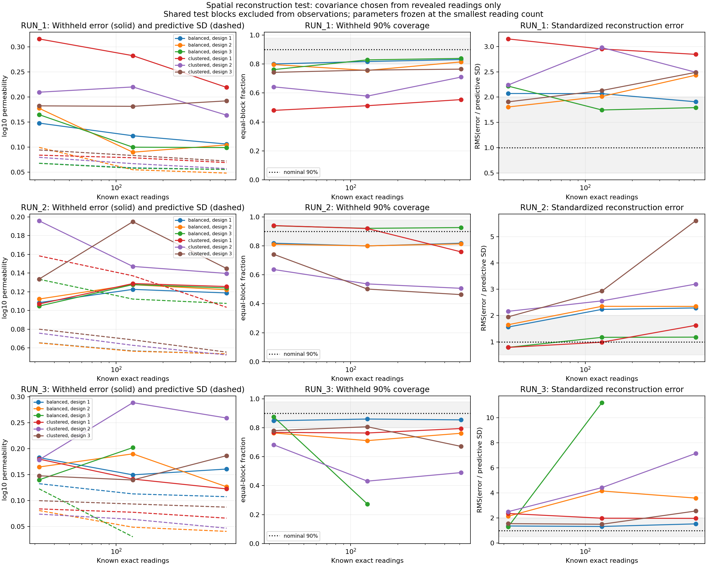

# Withheld reconstruction uncertainty: 25 October 2026

**The selected uncertainty laws do not reliably represent withheld reconstruction
error across this study. Fifteen of 54 cases pass the declared exploratory checks.
The workflow therefore stops before generating native ensembles or querying the
temperature model.**

This result remains the RUN-based realism test. The main
[controlled conditional-field benchmark](controlled_field_benchmark.md) tests
propagation under a declared known law; it does not replace this assessment or
establish that the tested RUN reconstruction laws are calibrated.

The [workflow](measurement_density.md) and
[executed configuration](../configs/measurement_density.validation.yaml) separate
model selection from test evaluation. The [portable summary](measurement_density_validation_summary.json)
records the study identity and implementation hashes. Full local output is
`run_output/measurement_density_validation_20261025`.

## Executed design

- Three separate 2560 x 2560, 5 m reference fields.
- Three independent balanced layouts and three independent clustered layouts per
  reference, each with nested exact counts 32, 128 and 512: 18 layouts and 54 cases.
- Sixteen randomly reserved 1600 m test blocks per reference, shared by its layouts
  and counts. All observations exclude the blocks and a 320 m buffer.
- 6400 test point samples per reference at 80 m spacing. No spatial averaging is
  substituted for point values.
- Twenty-seven externally declared candidates: Gaussian, radial Matérn-3/2 and
  radial exponential, isotropic lengths 500/1500/3000 m, log10 amplitudes
  0.1/0.2/0.3. They are assumptions, not full-reference fits.
- Spatial-block CV using only the first 32 readings selects a covariance per layout.
  Family, length and amplitude are frozen over the larger budgets. At each count,
  only its revealed readings determine the ordinary-kriging mean.

The Gaussian posterior diagnostics are analytic and require no MC field draws.
The full reference mean, full-reference texture fits, test values and future
readings do not enter model selection. The test references are existing project
windows, not newly collected independent geology.

## Results

| Reference | Balanced cases passing | Clustered cases passing | Total passing |
|---|---:|---:|---:|
| RUN_1 | 3 / 9 | 0 / 9 | 3 / 18 |
| RUN_2 | 5 / 9 | 2 / 9 | 7 / 18 |
| RUN_3 | 4 / 9 | 1 / 9 | 5 / 18 |
| All cases | 12 / 27 | 3 / 27 | 15 / 54 |

These are counts of cases meeting explicit descriptive tolerances. Cases share
references, locations, readings and test blocks; they are not independent trials.
Only two of the 18 layouts meet the checks at all three counts.

Solid lines in the first column show withheld log10 reconstruction RMSE; dashed
lines show RMS predictive SD. The second column gives the fraction covered by
nominal 90% intervals, averaged equally over test blocks. The third column shows
RMS(error / local predictive SD). Dotted lines mark nominal coverage or standardized
RMS one; shaded bands mark the configured exploratory tolerances. Layout curves
remain separate. An unavailable endpoint is omitted from its numerical curve and
recorded explicitly in the detailed results.

The dominant failure is overconfidence. At 512 readings, none of the nine
clustered cases passes all checks. Adding more readings in an already sampled
region reduces posterior variance but can leave substantial errors in withheld
regions. This is not resolved by increasing the number of MC samples.

For example, RUN_3/clustered/layout 2 at 512 readings has withheld RMSE about
0.259 log10 units, RMS predicted SD about 0.0466, nominal 90% coverage **49.0%**,
and standardized RMS error **7.15**. Mean error and local predictive SD need to be
assessed together; an average uncertainty map alone conceals this discrepancy.

The RUN_3/balanced/layout-3 Gaussian candidate passes the checks at 32 readings,
but at 128 its nominal 90% interval covers only **27.3%** of the test points and
standardized RMS error is **11.21**. At 512 its exact-observation covariance fails
the declared numerical rank tolerance. This case is recorded as unavailable.
No nugget, pseudoinverse relaxation or test-informed replacement is introduced.

The first-32-reading selection chooses a 3000 m length in 15 of 18 layouts and the
lowest candidate amplitude, 0.1, in 12 layouts. Those boundary selections describe
this finite candidate comparison. They do not establish an optimum outside the
grid, and the test was not reused to expand the grid until coverage improved.

## Interpretation and scope

The assessment checks how the model performs in explicitly missing spatial
regions with a buffer. It is not an estimate of average error at arbitrary
randomly missing cells next to observations. Poor performance can reflect a
misspecified stationary/constant-mean law, unrepresented parameter uncertainty,
or insufficient regional information in the first reading set. The current data
do not isolate a unique cause.

The acceptance tolerances were fixed in the executed configuration: at least
eight test blocks, equal-block 90% coverage in [0.80, 0.98], standardized RMS in
[0.5, 2.0], and absolute standardized bias at most 0.5. They are exploratory model
checks rather than physical safety criteria or formal tests. Even some passing
cases remain below nominal 90% coverage. No independent-pixel confidence interval
or pooled geological probability is claimed.

All 53 numerically available cases retain decreasing average posterior variance
on the same test points as nested observations are added. Reconstruction error
and coverage need not improve monotonically. The adequacy failure therefore
concerns uncertainty modelling, not a failure of the Gaussian variance update.

The appropriate next experiment is to assess alternative mean structures and
parameter uncertainty, or a separately specified procedure that refits from each
current observation set. Any revision selected using these results needs a fresh
independent validation protocol. Temperature-risk conclusions from this current
law are deferred; the implemented propagation path remains available for studies
that pass their declared validation checks.

## Verification

Nine new validation regressions cover spatial exclusion, block folds, selection
independence from future/test readings, over-/underconfidence diagnostics, failed
validation blocking the model, unavailable larger budgets, repeated layouts,
input-cache recovery and corruption detection. Together with the 12 existing
measurement-density tests, the focused suite passes **21 tests**.
The final complete Python 3.12 suite passes **616 tests**, with two existing
constant-field skewness/kurtosis precision warnings. The wheel was built and
installed in a workspace-only prefix, and its measurement-density command was
checked against the installed package. CI now includes that command's help check.
No new remote-CI result is implied by these local checks.

An independent audit verified 116 source/configuration/reference hashes and
189 output hashes, all observation/reference values, geometric test buffers,
18 selected CV scores, all 53 available cases' diagnostics, and the one numerical
rank failure. Direct Cholesky/ordinary-kriging equations reproduce saved probe
means within 3.84e-13 log10 units and SDs within 6.51e-15. The audit confirms zero
generated native ensembles and zero temperature-model queries.

Audit record: `analysis/density_validation_20261025/audit.json` in the project
workspace. The complete case tables, per-block/uncertainty-bin diagnostics,
selected-candidate rankings, test predictions and frozen artifact ledger remain
in the local study directory. The overview image was visually inspected.
