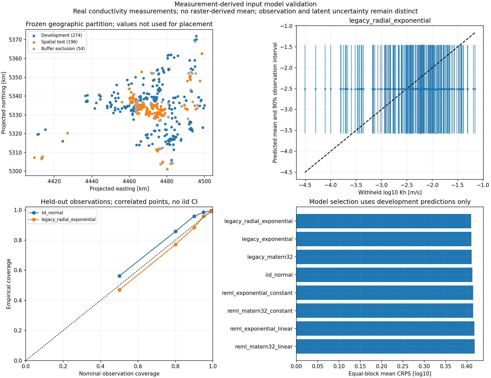
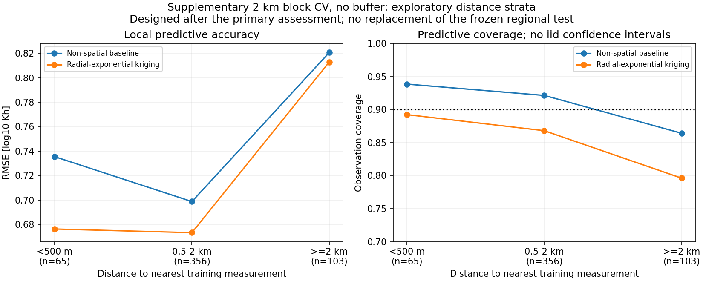

# Measurement-derived input model: validation and implications

**The current regional model does not pass the declared held-out observation
checks and is not validated as a geological permeability-input law for LGCNN
UQ.** There is exploratory evidence of useful interpolation close to real
measurements. That supports further local validation, not unrestricted regional
or native 5 m field claims.

Assessment date: 26 October 2026. Study: `measurement-model-3caad020ca6b6de5ffc9`.
The protocol, model choices and tolerances were frozen before development
selection and before scoring the reserved spatial test. No source data,
historical RUN fields or earlier study outputs were modified.

## Data and scientific target

The source is `kf_werte_190201.xlsx`, sheet `kf_werte_180223`, in the supplied
Munich measurement folder. Of 626 source rows, 524 have numeric positive
conductivity, Quaternary stratigraphy `q` and explicitly unconfined groundwater
state `ungespannt`. They occupy 523 distinct XY locations. All seven eligible
values above 0.05 m/s are retained. There is no upper-value clipping, trimming,
repair of broken formulas or imputation. The erroneous-coordinate source row
already fails the numeric-conductivity check and is not silently repaired.

Rows 480 and 481 share an XY coordinate but report 0.003265 and 0.00213 m/s.
Both are retained and assigned to the same split/fold. Their different values
cannot both be exact constraints on one two-dimensional value. This validation
uses a fitted positive residual nugget, whose physical origin remains unknown.

The response is **log10 hydraulic conductivity in m/s**. No conversion to
intrinsic permeability or LGCNN evaluation occurs. A fixed unit conversion is a
constant log shift and preserves these variance/coverage results, but the actual
training conversion still needs to be applied explicitly when constructing inputs.
`Rechtswert` is treated as easting and `Hochwert` as northing in metres, using the
working GK4 interpretation. The workbook itself has no authoritative CRS,
depth/screen/support or instrument-error declaration.

This assessment covers **all eligible regional measurements**. It does not crop
them to the older 100 m model footprint or claim registration with any historical
12.8 km RUN domain. No TIFF, interpolated parent mean, 3-D reference surface,
training RUN value or temperature output enters fitting or validation. This
avoids possible reuse of withheld measurements through an upstream map.

## Frozen selection and spatial test

- Randomly reserve 25% of occupied **8 km blocks**: 12 test blocks containing
  **196 records**. Geometry alone chooses the blocks; 25% of blocks need not
  contain 25% of observations.
- Exclude a **1 km buffer around complete test-block rectangles**. This removes
  54 additional observations from training and leaves **274 development records**.
- Select models using four development folds of complete **4 km blocks**, also
  with 1 km buffers. Every mean, covariance and residual parameter is re-estimated
  from that fold's training observations only. Colocated records stay together.
- Compare the legacy separable Matern-3/2, separable exponential and radial
  exponential variogram fits; four REML radial models with constant/linear means;
  and a non-spatial Gaussian predictive baseline.
- Select the spatial uncertainty candidate by **equal-block CRPS**. Separately
  reproduce the legacy choice by **point-weighted RMSE**. Save both choices
  before scoring the outer test. Neither rule selects the non-spatial baseline,
  which remains the explicit usefulness comparator.

Both selection rules chose `legacy_radial_exponential`. The four REML alternatives
were evaluated in development and were not selected; their outer-test performance
is not asserted. All candidates produced valid predictions in every development
fold; no candidate was unavailable. The legacy fitter does not expose its
optimizer convergence flag in the returned calibration artifact.

| Development candidate | Equal-block CRPS [log10] | Point RMSE [log10] | Equal-block coverage90 |
|---|---:|---:|---:|
| legacy_radial_exponential | 0.4099 | 0.7597 | 0.911 |
| legacy_exponential | 0.4103 | 0.7617 | 0.910 |
| legacy_matern32 | 0.4110 | 0.7621 | 0.910 |
| iid_normal | 0.4130 | 0.7661 | 0.918 |
| reml_exponential_constant | 0.4145 | 0.7673 | 0.925 |
| reml_matern32_constant | 0.4146 | 0.7677 | 0.925 |
| reml_exponential_linear | 0.4176 | 0.7818 | 0.936 |
| reml_matern32_linear | 0.4180 | 0.7825 | 0.930 |

These are selection diagnostics, not independent final assessment scores. The
best spatial candidate improves development CRPS by less than 1% over the
non-spatial baseline, already suggesting weak transferable spatial information
at this separation scale.

## Reserved-test result

| Model | Point RMSE [log10] | Point CRPS [log10] | Equal-block CRPS [log10] | Point coverage90 | Equal-block coverage90 |
|---|---:|---:|---:|---:|---:|
| iid_normal | 0.6601 | 0.3766 | 0.5815 | 95.9% | 77.0% |
| legacy_radial_exponential | 0.6605 | 0.3753 | 0.5952 | 88.3% | 69.3% |

The selected model's standardized residual RMS is 1.023.
It provides -2.4% CRPS improvement
under equal block weights, i.e. it is worse than the baseline. The paired
occupied-block bootstrap interval for spatial-minus-baseline CRPS is
[0.00034,
0.02951] log10 units. This is an exploratory
block-resampling diagnostic, not a proof of independent blocks or a simultaneous
significance test.

The point-weighted 90% coverage of 88.3% looks much more favourable
than the equal-block value of 69.3%. Two densely observed test
blocks contain 71 and 62 records, while some poorly predicted sparse blocks
contain only one or two. Reporting both weightings prevents the dense areas from
hiding that geographic weakness. Equal occupied-block weighting is still not a
validated area-uniform prediction over unobserved terrain or an entire LGCNN grid.

The predeclared exploratory checks require at least eight test blocks, equal-block
90% coverage in [0.80,0.98], standardized RMS in [0.75,1.50], absolute standardized
bias <=0.35, at least 5% CRPS improvement, and a negative upper endpoint of the
paired bootstrap CRPS difference. The selected model fails the coverage and
usefulness conditions. These tolerances were not relaxed after observing results.



## Why the primary model adds little information here

The selected training fit estimates correlation lengths of approximately
642 m east-west and 106 m north-south.
Its structured SD is 0.563 log10 units and residual nugget
SD is 0.317; the nugget is 24.1% of fitted
unconditional observation variance. That is not an identified fraction of
instrument noise or of physical 5 m geological variance.

The held-out sites are 1.42-13.20 km from their nearest retained training point,
with median distance about 3.95 km. Under the fitted short-range kernel, their
means therefore return almost entirely to the regional constant mean. The
horizontal prediction band in the figure is a real result, not a plotting error.
This assessment tests prediction across unmeasured geographic gaps; it cannot
establish whether a model is useful immediately beside a measured location.

## Supplementary local-information diagnostic

After inspecting the primary result, the existing API was also replayed with its
historical **five-fold 2 km block CV and no buffer**, on the same 524 regional
records. All three legacy kernels and the non-spatial baseline are reported;
no family is reselected and the reserved-test result is not replaced. This
supplementary diagnostic is explicitly exploratory, not a new independent test
or a reproduction of the older reference-footprint subset.

With all predictions pooled, radial-exponential kriging gives RMSE 0.7032 versus
0.7288 for the baseline, and point CRPS 0.3880 versus 0.4014. Its nominal 90%
coverage is 85.7% versus 91.2% for the baseline. Nearest-training distances are
smaller, with median about 1.11 km.

In a **post-hoc distance stratum** of 65 predictions within 500 m of training
data, kriging reduces RMSE from 0.7355 to 0.6762
(about 8.1%), CRPS from
0.3749 to 0.3536, and obtains
89.2% coverage for nominal 90% intervals. This suggests useful
local interpolation, but correlated points and post-hoc stratification preclude
a claim of independently validated local calibration. The gain largely disappears
at distances >=2 km.



## Statistical model and numerical verification

The legacy candidates use the existing pair-count-weighted directional variogram
fit (250 m bins, maximum lag 3 km, angle tolerance 22.5 degrees, >=8 pairs/bin),
including fitted structured and nugget variance. The legacy mean is the training
sample log mean and is treated as known when computing prediction variance.
There is no KL truncation in these full-covariance point predictions; the
assessment does not validate the older KL conditioning bridge.

The REML candidates use

`y = H beta + u + epsilon`, with `Cov(u)=sigma^2 R(length)` and
`Cov(epsilon)=tau^2 I`.

They fit length, structured SD and residual SD by restricted Gaussian likelihood,
using three declared starting lengths (500,2500,10000 m) and fixed bounds:
length 100-50000 m, structured SD 0.01-3 and residual SD 0.0001-3 log10 units.
They include GLS mean-parameter uncertainty in the universal-kriging variance.
Covariance-parameter uncertainty is not propagated. All candidates score the
**new-observation variance**, including the residual nugget, and separately retain
the smooth latent variance. A source measurement is never assumed to be an exact
noise-free 5 m cell constraint.

The independent audit re-read the source inclusion decisions, verified all
119 source hashes and archived sources, reconstructed predictions for
32 development model/fold fits and 2 outer fits,
checked buffers and colocated groups, and independently recomputed scores and
bootstrap intervals. Maximum mean and variance differences were
1.33e-15 and
1.11e-16, respectively.
The final local suite passes **640 tests**. Meaningful new tests cover REML
gradients, universal-kriging variance, grouped geometry, held-out-value leakage,
source/cache corruption and the separation of observation and latent uncertainty.

The code and configuration are in
`src/subsurface_uq/experiments/measurement_model_validation.py`,
`src/subsurface_uq/validation/measurement_model.py`, and
`configs/measurement_model.validation.yaml`. The installed command is
`subsurface-uq-measurement-model-validation`.

```powershell
python -m subsurface_uq.experiments.measurement_model_validation --config configs/measurement_model.validation.yaml --output-dir run_output/measurement_model_validation_new --stage all
```

Stages are `plan`, `develop`, `evaluate`, `report` and `all`. Planning and `all`
require a fresh directory. Resume the interrupted specific stage using the same
configuration and Python/package installation. Selection and completed artifacts
are hash checked; changing source, configuration or original measurements requires
a fresh study. An interrupted development stage refits deterministically rather
than mixing partial fold selections. The source workbook remains read-only.
Install the geostatistical optional dependencies for its Excel reader.

The [portable summary](measurement_model_validation_summary.json) contains the
protocol, results, diagnostic labels and source fingerprints. Full data and
per-observation predictions remain local under
`run_output/measurement_model_validation_20261026`; the independent audit and
supplementary script are under `../analysis/measurement_model_validation_20261026`.
The original workbook, all synced project references and earlier frozen studies
remain unchanged. No fields or LGCNN predictions were generated.

## Consequence for the thesis workflow

The [controlled conditional-field benchmark](controlled_field_benchmark.md)
remains the main method-consistency experiment. The
[RUN reconstruction challenge](measurement_density_results.md) remains a separate
structural realism test. Neither substitutes for held-out real measurements.
The current regional measurement fit should not be promoted to a calibrated
native LGCNN input law on the evidence above.

The next useful work is to define the geographic/aquifer support of the intended
site and quantify its distance to measurements; clarify depth/support and the
physical allocation of residual variance; then test a local or geological-stratum
model with new validation separation. Independent geological covariates may be
useful. An interpolated conductivity map potentially built from these same
observations cannot be treated as an independent drift or test truth without
addressing that data reuse. Historical RUN registration is required for claims
about their original locations, while a new explicitly georeferenced site can be
defined separately. A 5 m joint field law and LGCNN compatibility require further
checks even if an observation predictor passes its own diagnostics.

References: [scikit-learn validation and model-selection guidance](https://scikit-learn.org/stable/modules/cross_validation.html),
[GSTools geostatistical modelling paper](https://gmd.copernicus.org/articles/15/3161/2022/).
