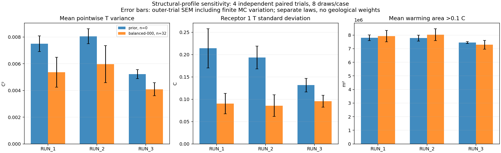

# Structural-profile sensitivity: completed reduced LGCNN experiment

Study `controlled-62769209889494f0b001`, profile set `structural-7372b21f1bbd78d1d5a8`.

The illustrative parameters have been replaced for the primary experiment by three source-derived structural laws. The native pilot completed **204 actual frozen LGCNN evaluations**, including 12 independent hidden-truth evaluations. Each profile has four independent paired trials and eight MC draws for each of two cases: no readings and 32 balanced exact readings. These are synthetic map-structure priors; geological probabilities and LGCNN-versus-simulator discrepancy remain unquantified.

See [profile derivation and reproduction](structural_profiles.md) and [portable complete numerical summary](structural_profile_results_summary.json).

## Dependence on profile and information

Entries show the mean across four outer trials ± one outer-trial standard error. The error includes the variability of eight-draw MC estimates. It is not a geological parameter confidence interval.

| Profile | Readings | Average pointwise T variance [C²] | Receptor 1 T SD [C] | Mean warming area >0.1 C [km²] |
|---|---:|---:|---:|---:|
| RUN 1 | 0 | 0.0075018 ± 0.00059 | 0.21404 ± 0.044 | 7.8003 ± 0.21 |
| RUN 2 | 0 | 0.0080518 ± 0.00056 | 0.19356 ± 0.026 | 7.7788 ± 0.22 |
| RUN 3 | 0 | 0.0052218 ± 0.00034 | 0.13154 ± 0.015 | 7.4602 ± 0.069 |
| RUN 1 | 32 | 0.0053589 ± 0.0011 | 0.09028 ± 0.023 | 7.9311 ± 0.42 |
| RUN 2 | 32 | 0.0059652 ± 0.0014 | 0.08559 ± 0.024 | 8.0293 ± 0.44 |
| RUN 3 | 32 | 0.0040846 ± 0.00049 | 0.095422 ± 0.013 | 7.2912 ± 0.32 |

| Profile | Exact average log-k variance reduction with 32 readings | Estimated average T variance reduction |
|---|---:|---:|
| RUN 1 | 71.9% | 28.6% |
| RUN 2 | 77.2% | 25.9% |
| RUN 3 | 33.2% | 21.8% |

The input reductions are analytical for the declared covariance and fixed layout. Temperature reductions are ratios of the estimated outer-trial average variances, with paired absolute changes and their SEM retained in the JSON. Nonlinear conditional temperature variance can increase for a particular data set; no such result is removed.

## Paired joint-profile comparisons against RUN 2

RUN 2 supplies the fixed pressure/material/source context. Contrasts use common Gaussian driving modes and geometry; each profile generates its own exact synthetic readings. Thus they measure a joint change of the input law and model-consistent data, rather than a parameter-wise causal effect at a fixed real data set.

| Profile minus RUN 2 | Readings | Paired difference in average T variance [C²] | Paired difference in receptor 1 T SD [C] | RMS difference of mean T fields [C] |
|---|---:|---:|---:|---:|
| RUN 1 | 0 | -0.00055006 ± 0.00012 | 0.020478 ± 0.025 | 0.020674 ± 0.0017 |
| RUN 3 | 0 | -0.00283 ± 0.00024 | -0.062015 ± 0.017 | 0.03809 ± 0.001 |
| RUN 1 | 32 | -0.00060631 ± 0.00028 | 0.0046901 ± 0.0013 | 0.015215 ± 0.0021 |
| RUN 3 | 32 | -0.0018806 ± 0.00093 | 0.0098327 ± 0.029 | 0.038803 ± 0.0061 |

## Assessment and next experiment

Profile choice materially changes absolute output spread in this controlled pilot: RUN 3 has 35.1% lower prior average temperature variance than RUN 2. The estimated benefit of 32 readings is less different for temperature than for log permeability. Local receptor uncertainty can follow a different ordering from average field variance; a single conservative profile is not established across these quantities. Conditional profile contrasts and tail estimates remain imprecise at this budget.

Keep all three profiles separate in the larger experiment, using RUN 2 as the fixed-context reference rather than selecting a preferred law from its temperature spread. The 16-truth/32-draw matrix is a useful next sensitivity check, not a guaranteed adequate final budget. Increase independent truth and MC budgets where the reported sampling errors remain too large. Retain the RUN reconstruction challenge as the separate realism assessment; these synthetic laws do not reverse its failed result.

## Evidence and limits

The independent native audit passed: 24 cases, 204 queries, 648 artifact-hash checks and independent conditioning/statistics calculations. The maximum independent Matheron discrepancy was 4.19e-08 log10; maximum exact-reading conversion error was 2.5e-08 log10. The independent full signed-grid calculation reproduced the profile variance identities. The full local suite passes 649 tests. A final 24-test focused run also checks the portable source paths and Gaussian-field metadata. Those final formatting corrections do not alter fitted parameters, draws or model queries; the original hashed execution sources remain archived.

Nested four-versus-eight draw checks reach 0.0342 C RMS difference in mean fields and 0.0482 C in SD fields. Across individual cases the four-draw variance estimates differ from the eight-draw estimates by -32.2% to 10.9%. Prefixes share draws, so their agreement is not an independent convergence test. Eight draws and four truths do not establish tail-risk accuracy or precise coverage. Ranks have nine bins and an attainable central coverage of 7/9, with wide exact binomial intervals over four truths. Receptor risks can have only nine empirical probability values per case; full per-case risk intervals remain in the native outputs.

Across all queries, the maximum fraction outside checkpoint normalization ranges is 0% below and 0% above. This is descriptive and does not certify model training support or physical accuracy.

All 48 structural diagnostics draws were retained. Source variogram mismatches, roughness departures and connectivity differences are documented rather than hidden by rejection or moment normalization. Source files and the separate failed RUN realism result remain unchanged.

The larger profile matrix is planned and densely validated: 16 paired truths, 32 draws, counts 0/8/32 and balanced/clustered layouts, **7728 LGCNN evaluations**. It uses fresh independent streams; its model propagation has not run. Use it to test whether profile contrasts persist with more trials and draws. Increase independent MC budgets where risk estimates remain unstable; do not tune source profiles to these temperature outputs.
