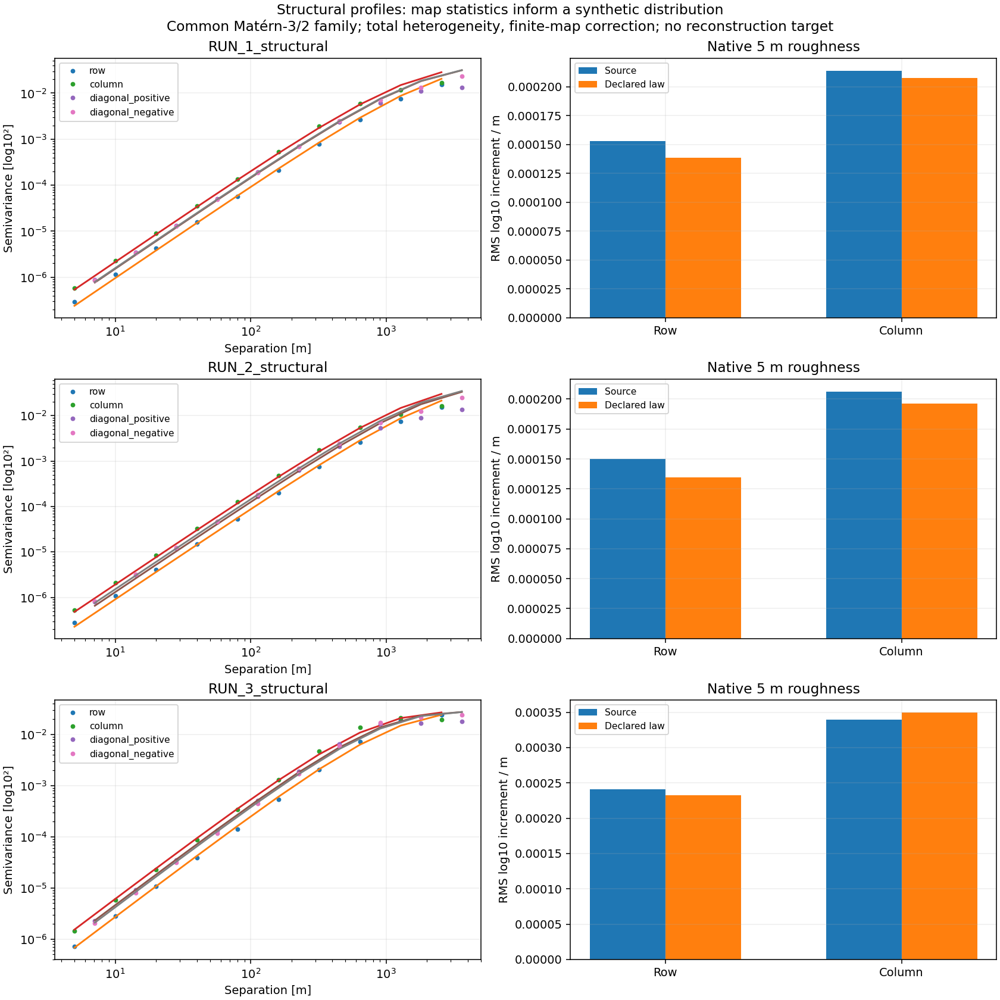
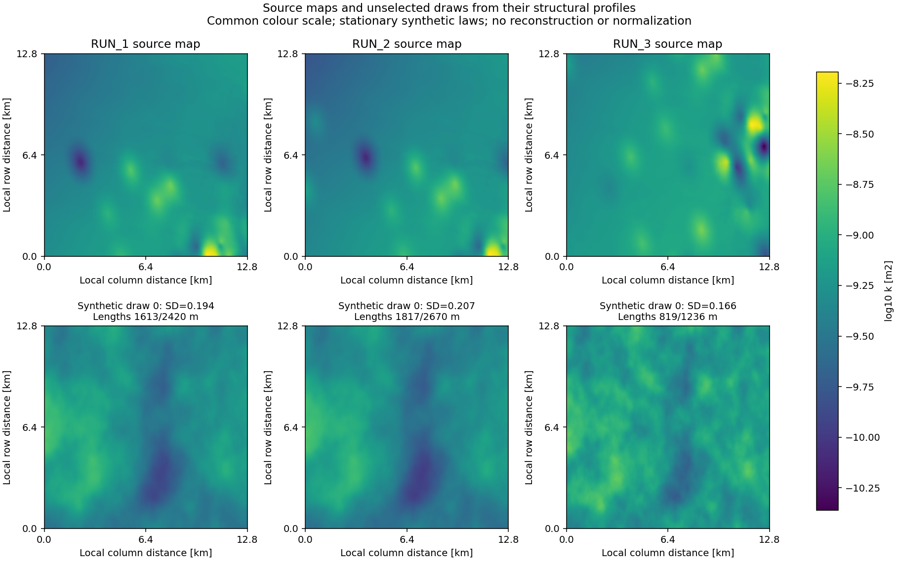

# Map-informed structural profiles for the controlled benchmark

The primary synthetic input laws now come from the supplied RUN 1, RUN 2 and
RUN 3 permeability maps. The illustrative isotropic parameters are retained
only in the historical execution pilot. The new laws describe plausible
**processed-map structure**, with a fully specified sampling distribution.
They do not estimate the probability of Munich geology or the error of the
original interpolation. The separate RUN reconstruction challenge and the
measurement-only validation keep their previous, unsuccessful assessments.
The [reduced experiment results](structural_profile_results.md) report the
corresponding temperature sensitivity and Monte Carlo limitations.

## Sources and probability model

`configs/structural_profile_fit.yaml` names the three native arrays prepared
from the supplied real-K dataset. `configs/structural_profiles.json` records
their SHA256 hashes, preparation-manifest hash, units, grid, fitting settings,
source-code hashes, optimizer results and fitted directional variograms.
Each array is 2560 by 2560 cells at 5 m, in intrinsic permeability m².
They come from `dataset_100hp_giant_real_fixP0_0025`; use the
[native reference preparation](reference_pilot.md) if the arrays are absent.
The profile study uses the three already prepared RUNs, rather than claiming
to characterize every training window or every supplied TIFF.
The RUNs may be overlapping windows of one interpolated parent map. They are
three structural alternatives, not three independent geological realizations.

For profile p, define the complete joint law

\[
Y_p(x)=\log_{10}(k_p(x)/[\mathrm{m}^2])=\mu_p+\sigma_p Z_p(x),\quad
Z_p\sim\mathcal{GP}(0,\rho_p),\quad k_p=10^{Y_p}\,\mathrm{m}^2.
\]

All profiles use the stationary, anisotropic Matérn-3/2 correlation
\(\rho=(1+\sqrt{3}r)e^{-\sqrt{3}r}\), where r is the rotated distance
scaled by the two fitted length parameters. This family is a declared
finite-smoothness assumption, motivated by the smooth processed maps;
neither the family nor stationarity is proved by three maps. It gives a
positive joint distribution with interpretable covariance and exact Gaussian
conditioning. The lognormal random-field/kriging framework is described in
[Müller et al. (2022)](https://gmd.copernicus.org/articles/15/3161/2022/).
Our native sampler uses circulant embedding rather than GSTools' default
randomization method; its numerical checks remain explicit.

| Profile | Fixed log10 mean | Pointwise log10 SD | Minor length [m] | Major length [m] | Major-axis angle [degrees] |
|---|---:|---:|---:|---:|---:|
| RUN 1 | -9.291893 | 0.193611 | 1612.8 | 2419.6 | 88.77 |
| RUN 2 | -9.320611 | 0.206796 | 1816.9 | 2669.8 | 84.32 |
| RUN 3 | -9.157024 | 0.166143 | 819.4 | 1236.3 | -86.37 |

These are Matérn scale parameters, not practical variogram ranges. The angle
runs from positive column toward positive row in each array; no historical
geographic orientation is inferred. RUN 2 is the sensitivity reference because
the fixed pressure, sources and material context also come from RUN 2. This
does not make RUN 2 a more probable geological scenario.

## Estimation and checks before temperature propagation

The mean is the full-map spatial mean of log10 permeability. Empirical
semivariograms use all nonperiodic pairs at lags 1, 2, 4, 8, 16, 32, 64, 128,
256 and 512 cells, along rows, columns and both diagonals. Fitting minimizes
equally weighted squared **log-semivariogram** residuals across these 40
direction/lag combinations. Pixel pairs are correlated, so they do not supply
an iid likelihood or confidence interval. Length bounds are 50–12800 m; three
initial angles are tried, all converge, and no selected length reaches a bound.

The finite map's population spatial variance v is generally smaller than the
pointwise prior variance. For N grid cells,

\[
q=N^{-2}\sum_{i,j}\rho(x_i-x_j),\qquad
E[N^{-1}\sum_i(Y_i-\bar Y)^2]=\sigma^2(1-q).
\]

We therefore use \(\sigma^2=v/(1-q)\). During optimization q uses
48-point quadrature on each axis; the final variance uses the exact discrete
lag-weighted sum over the native grid. The resulting q values are 0.10724,
0.12799 and 0.03299. The map's total heterogeneity informs sigma; a withheld
reconstruction residual or a nugget is not used as total field variance.
Generated realizations retain random means, variances and histograms.

Sixteen independent native draws per profile check moments, quantiles,
directional semivariograms and native gradients. Their Gaussian driving modes
are shared across profiles, so the 48 fields are not 48 independent profile
comparisons. At 40 m diagnostic spacing,
four-neighbour high/low connected components use fixed thresholds
\(\mu\pm1.28155\sigma\); these thresholds are not recalculated per draw.
The mean generated spatial variances are 0.03381, 0.03803 and 0.02641 log10²,
compared with targets 0.03347, 0.03729 and 0.02669. No draw is selected,
rejected, clipped or rescaled to improve agreement.

The maximum fitted/source semivariance discrepancies across the declared
direction/lag combinations are factors 2.36, 2.48 and 1.54. The law's native
row-gradient RMS is about 10% below RUN 1 and RUN 2; some source roughness and
connectivity statistics fall outside the finite 16-draw descriptive envelope.
These mismatches remain visible. This is a useful structural approximation,
not a claim of exact map resemblance, tail/connectivity preservation, or
independent geological validation. The 5 m grid is a computational support;
it does not establish independent field information at that scale.





The stationary draws spread heterogeneity across the domain, whereas some
source maps contain localized interpolated anomalies and broad smooth regions.
Directional second-order agreement does not establish agreement of those
higher-order patterns. The figures and fixed-threshold connectivity checks
make this limitation visible.

## Controlled conditioning and profile sensitivity

`configs/controlled_field.profiles.pilot.yaml` is the reduced sensitivity
experiment: three profiles, four independent paired hidden truths per profile,
eight MC draws per case, and zero versus 32 balanced exact synthetic readings.
This requires **204 actual LGCNN evaluations**, including the 12 hidden truths.
Pressure, source locations, material inputs, model weights, output crop and
receptors remain fixed. Profiles were frozen from input maps before any of
these temperature outputs were observed.

Average input variance uses the full 12.8 km by 12.8 km permeability grid.
Average temperature variance uses the fixed 1028 by 1028 valid output crop
(5.14 km by 5.14 km), with its original surrounding input context. These
percentages summarize different domains and quantities; input variance
reduction need not translate proportionally into temperature variance reduction.

All profiles use the same 8192 by 8192 FFT embedding, Gaussian driving modes,
geometry, trial indices and posterior sample indices. Each profile applies its
own covariance spectral factor, mean, variance and exact synthetic readings.
Truth and posterior streams are independent, as are outer trials. Thus each
profile has the correct marginal law, while common randomness reduces noise
in **paired joint-profile contrasts**. These contrasts change several input
properties together; they do not identify separate mean, variance, range or
angle effects. Conditioning within each profile also changes its own data.

The output includes analytical average input variance, temperature variance,
receptor temperatures/SD, ROI mean/maximum, warming areas, risk maps and
paired changes against RUN 2. Nested 4/8-draw checkpoints and outer-trial
standard errors show the pilot's Monte Carlo limitations. The four truths
are the replication units; correlated pixels and paired profiles are not
additional independent observations. Profiles have **no probability weights**
and their temperature samples are not pooled into a geological mixture.

The planned extension, `configs/controlled_field.profiles.main.yaml`, adds
16 paired truths, 32 draws, counts 0/8/32 and both balanced and clustered
layouts: **7728 evaluations**. It is a separate specification with fresh random
streams, frozen without selecting favourable pilot truths. Tail-risk
claims require further independent MC convergence checks; neither 8 nor 32
draws automatically establishes them. This input-UQ study does not validate
LGCNN against a physical simulator.

## Reproduction

Run from the repository root with the project installed:

```powershell
subsurface-uq-structural-profiles --config configs/structural_profile_fit.yaml --output configs/structural_profiles.new.json --report-dir run_output/structural_profiles_new --stage all
subsurface-uq-controlled-fields --config configs/controlled_field.profiles.pilot.yaml --output-dir run_output/controlled_profiles_new --stage all
```

Fitting requires fresh output names and never overwrites the frozen artifact.
The benchmark checks exact agreement between its declared laws and that
artifact, and hashes the original map arrays and preparation manifest before
execution and at completion. A changed profile, source map, model or execution
source requires a fresh run or the original frozen execution context.

Historical `controlled_field.pilot.yaml` and `controlled_field.main.yaml`
remain reproducible records of the earlier illustrative-law experiment.
They are superseded as the primary structural experiment.
